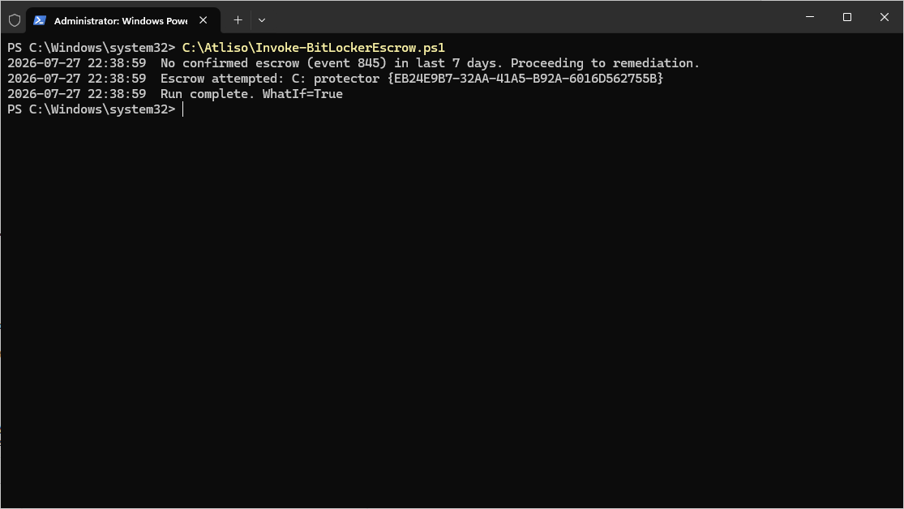
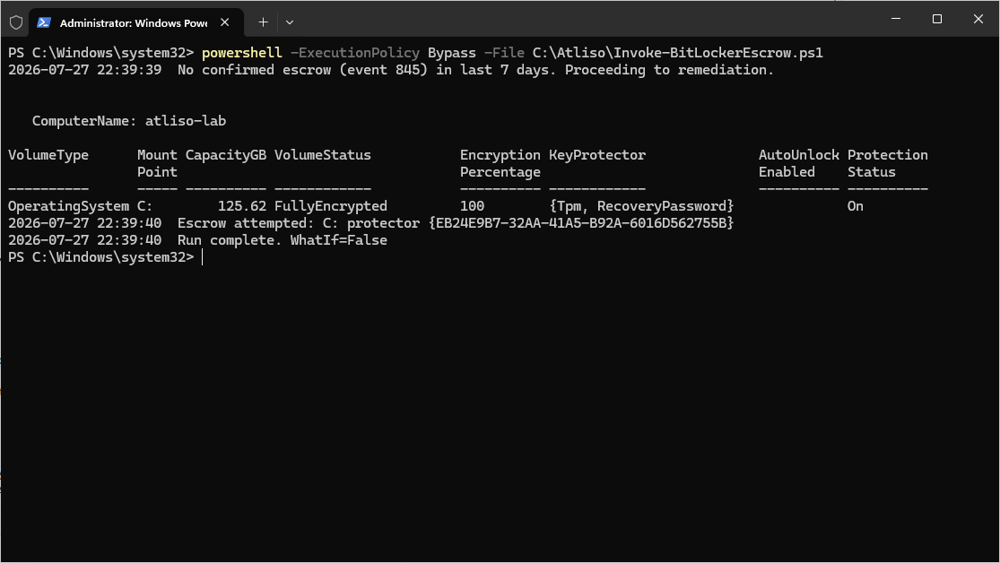
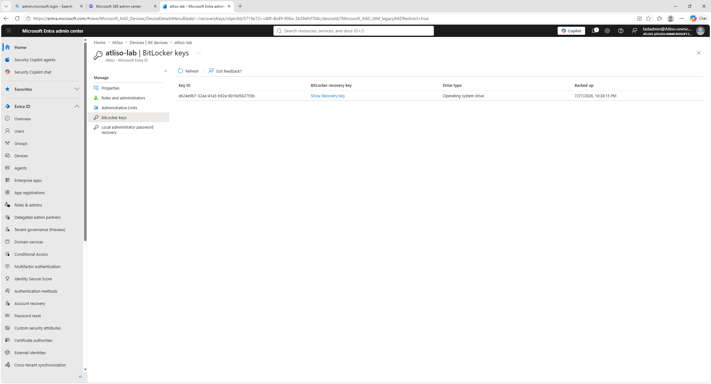

# BitLocker Escrow

[](https://www.powershellgallery.com/packages/Atliso-BitLockerEscrow)

PowerShell script that checks whether a device's BitLocker recovery key actually made it to Entra ID, and forces the backup when it did not.

BitLocker can report as fully encrypted while the recovery password never escrowed to Entra ID. The device looks compliant right up until someone needs the key and it is not there. This script confirms the escrow really happened, and forces it when it did not.

## What it does

- Checks for event 845 in the BitLocker-API/Management log, which is written when a key is backed up to Entra ID successfully
- Treats a device as escrowed if that event was logged inside your chosen window, so an already-backed-up key is not re-sent every run
- Forces the backup with `BackupToAAD-BitLockerKeyProtector` for every RecoveryPassword protector when nothing is confirmed
- Handles the awkward cases: no recovery protector present, or more than one protector on a volume
- Reports only by default. Nothing changes until you set `-WhatIf $false`
- Logs every action to `%LOCALAPPDATA%\Atliso\BitLockerEscrow.log`

## Install

From the [PowerShell Gallery](https://www.powershellgallery.com/packages/Atliso-BitLockerEscrow):

```powershell
Install-Script Atliso-BitLockerEscrow -Scope CurrentUser
```

Or download `Atliso-BitLockerEscrow.ps1` from this repo or the [latest release](../../releases/latest).

## Quick start

1. Download [`Atliso-BitLockerEscrow.ps1`](Atliso-BitLockerEscrow.ps1)
2. Open the top of the script and set the config for your environment:

```powershell
$VolumesToCheck = @("C:")   # add data volumes if you encrypt them
$MaxAgeDays     = 7          # a confirmed backup inside this window counts as escrowed
$WhatIf         = $true      # $false to actually force the escrow
```

3. Run it to audit, then set `$WhatIf` to `$false` to remediate.

## Deploy in Intune

Deploy it as a Remediation so it runs on a schedule and self-heals.

1. In the Intune admin center: **Devices > Scripts and remediations > Remediations** > Create.
2. Use the detection half (exits 1 when no recent escrow is confirmed) as the detection script.
3. Use this script with `-WhatIf $false` as the remediation script.
4. Run as **SYSTEM**, **64-bit**.

## What it looks like

Detection on a device where the key never escrowed:



Remediation forcing the backup:



The recovery key present in Entra ID afterwards:



## Requirements

- Windows 10 or 11 with BitLocker enabled
- PowerShell 5.1 or later
- A RecoveryPassword protector on each volume you want escrowed
- Rights to call `BackupToAAD-BitLockerKeyProtector` (runs as SYSTEM under Intune)

## Full guide

Step by step, with screenshots: https://atliso.com/blog/bitlocker-recovery-key-escrow-fix

## License

MIT. Free to use, change, and ship. See [LICENSE](LICENSE).
